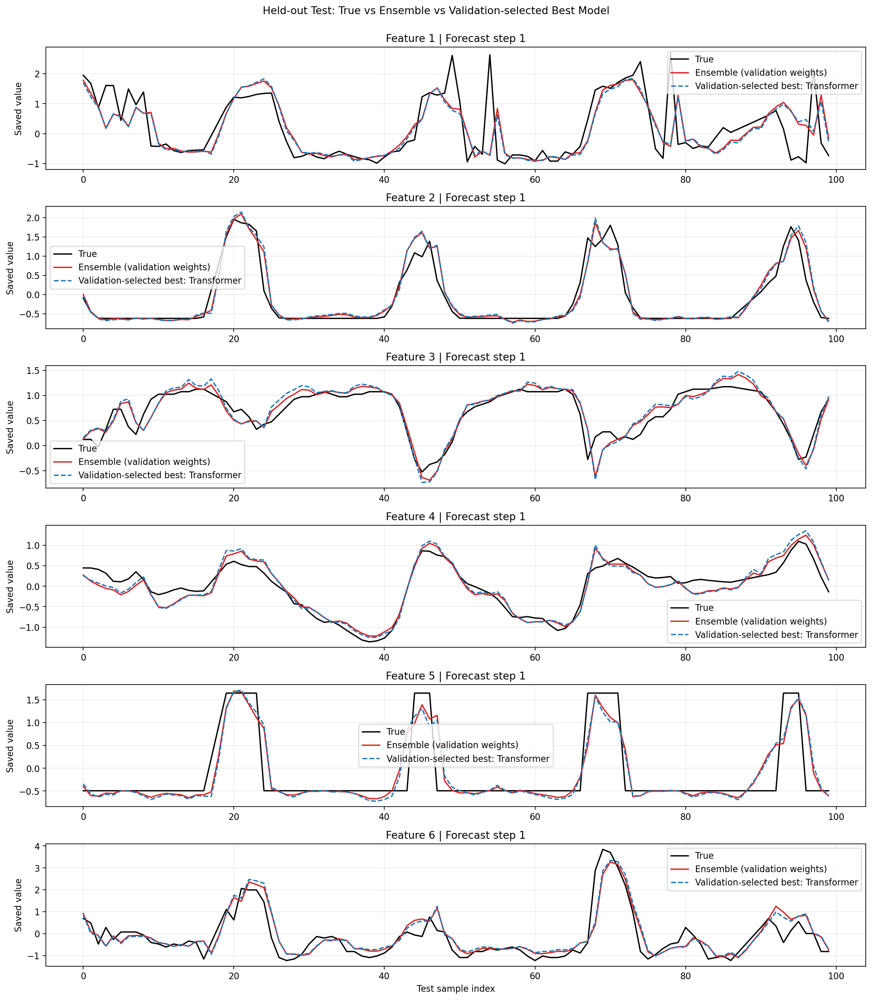

# 多模型加权融合与风速预测实验报告（无数据泄露版）

本实验基于 TSLib，针对加州站点风速数据进行多变量预测，并通过 SLSQP 凸优化算法实现多模型融合。

## 核心结论

基于验证集进行 `minimize()` 权重寻优，固定权重后应用于测试集，杜绝了融合权重寻优环节的测试集数据泄露。

- **最优权重分配**：Transformer (76.35%) 与 iTransformer (23.53%)，TimesNet (0.12%)，其余模型为 0。
- **性能提升**：融合模型在测试集上 R² 达到 **0.7381**，高于最佳单模型（Transformer R²=0.7286）。

## 测试集指标对比（441个样本，6个变量）

| 模型 / 方法 | MSE | MAE | R² | 备注 |
| :--- | :--- | :--- | :--- | :--- |
| 最佳单模型 (Transformer) | 0.2252 | 0.2780 | 0.7286 | 基线 |
| 等权融合 | 0.2250 | 0.2757 | 0.7287 | 未优化的平均值 |
| **验证集优化融合** | **0.2210** | **0.2668** | **0.7381** | **最终方案 (MSE 降低 1.83%)** |

*图注：融合模型与最佳单模型在测试集上的前100个样本预测对比。*

## 评估范围与复现说明

验证集包含 222 个样本，融合权重和单模型基线均由验证集确定，测试集仅用于固定方案的最终性能评价。标准化仅拟合训练段统计量。

表格按摘要格式截断至小数点后四位；完整精度权重和指标见 [ensemble_metrics.json](./ensemble_metrics.json)。指标沿用保存数组的尺度，R² 为六个输出变量得分的均匀平均。

“无数据泄露”限定于本次融合权重拟合及评价流程；原始特征选择与单模型训练全过程尚未全面审计。当前为单次实验的数值改善，未进行统计显著性检验，不据此宣称统计显著提升。
